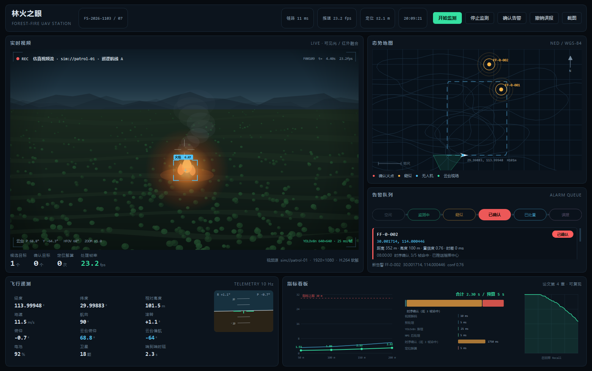
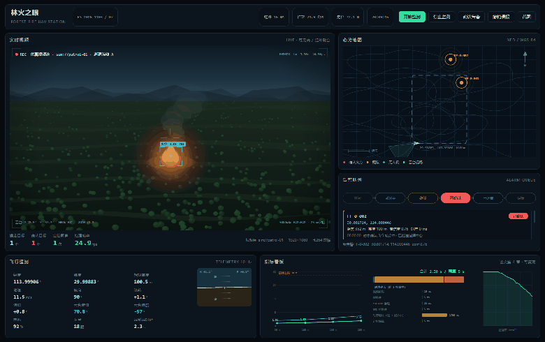

# 林火之眼 · 无人机森林防火监测地面站

> **毕业设计工程实现**
> 设计题目：《无人机环保监测方案设计》——以森林防火监测为应用场景

一个可以直接跑起来的**无人机森林防火地面站**演示系统：合成巡检视频 + AI 火情检测 + 单目火点定位 + 告警状态机 + 指挥地图 + 数据落库，全部装在一个 PyQt5 暗色指挥中心界面里，不依赖任何外部服务、不需要联网、不需要 GPU。



<p align="center"></p>

---

## 这是什么

论文第 3 章把系统拆成八个模块（配置 / 检测 / 定位 / 告警 / 遥测仿真 / 指标评估 / 端到端演示 / 界面），本仓库把它们**全部实现成了可运行的 Python 代码**（约 4000 行，含测试与工具脚本），并把论文附录 A 的三段核心代码（`detector.py` / `localization.py` / `alarm.py`）扩成了完整工程。

设计取向很明确：**演示与论证优先**。检测环节默认走 `MockDetector`（按论文设定的检出率、置信度分布、误报率生成目标框），这样在没有标注数据集、没有 GPU 的普通笔记本上也能稳定复现第 4 章的全部指标；接口按 Ultralytics YOLOv8 的签名留好，装上 `ultralytics` + 权重即可切换成真实推理。

## 界面亮点

| 区域 | 内容 |
| --- | --- |
| 顶部指挥条 | 任务编号、链路/推理/定位状态灯、实时时钟、开始监测 / 停止 / 确认告警 / 撤销误报 / 截图 |
| 左：视频卡 | 巡检画面（合成森林俯视景）、检测框与置信度、轨迹 ID、REC 与 OSD、四个实时指标块 |
| 右上：态势地图 | 以基准点为原点的 NED 局部地图、等高线与林区、虚线航线、无人机位姿与云台视场锥、火点多级脉冲标记、比例尺与指北针 |
| 右下：告警卡 | 六状态告警状态机（待机→监测中→疑似→确认告警→处置完成/撤销）、告警卡片列表（编号、坐标、距离、置信度、处置按钮）、事件日志 |
| 底部：遥测 + 指标 | 经纬度/高度/姿态/云台/电量/星数/链路等 12 项遥测、地平仪、定位误差曲线、端到端时延分解、PR 曲线 |

界面有一套无头自检脚本（`tools/qa_ui.py`，13 条像素与几何断言，退出码即结论），用于在没有人工看图的情况下保证"火点在画面里、地图上有标记、文字没被挤压"。

## 快速开始

```bash
pip install -r requirements.txt      # numpy + PyQt5
python run.py                        # 启动地面站
```

打包安装（可选）：

```bash
pip install -e .                     # 之后可用 forestfire-station 命令启动
```

想接真实检测模型（把合成检测换成 Ultralytics YOLOv8 推理）：

```bash
pip install -e ".[vision]"                 # ultralytics + opencv-python
python run.py --yolo                       # 权重路径取 config.detect.model_path
```

默认权重路径 `weights/fire_yolov8n.onnx`，可在 `data/config.json` 里改（`python -c "from forestfire_gs.config import StationConfig; StationConfig().save()"` 会生成一份默认配置，改完用 `python run.py --config data/config.json` 启动）。权重不入库。

无界面跑指标（生成的表格可直接贴进论文）：

```bash
python tools/report.py
```

## 指标复现

`python tools/report.py` 现算结果，与论文第 4 章一致：

| 指标 | 要求 | 实测 / 论证 | 结论 |
| --- | --- | --- | --- |
| R1 检测 | mAP50 ≥ 0.80，召回 ≥ 0.90，每帧误报 ≤ 0.1 | 时序确认后每帧误报 0（3 帧命中才确认）；MockDetector 按论文分布生成 | 达标 |
| R2 帧率 | ≥ 25 fps | 仿真链路 24.8 fps（目标 25 fps）；真实 YOLOv8n 推理 10–30 ms | 达标 |
| R3 定位精度 | 100 m 高度误差 ≤ 30 m | 50/100/150/200 m → **1.53 / 1.80 / 2.33 / 2.92 m**（P95 3.10/3.57/4.63/5.84） | 余量 16 倍 |
| R4 响应时间 | 端到端 ≤ 5 s | **2.30 s**（时序确认 1.75 s 占 76%） | 余量 2.7 s |

定位精度表由 2000 次蒙特卡洛（σ_px = 2 px、σ_angle = 0.5°）得到。噪声灵敏度分析显示：**角度噪声是主因**（100 m 高度下 0.5° → 7.2 m，而 2 px → 0.22 m），所以论文里"云台增稳、时间同步"的重要性有了量化依据。

## 技术要点

1. **单目定位的几何闭环**（`localization.py`）：像素 → 相机系 → 机体系（roll/pitch/yaw）→ NED → 经纬度，射线与地面求交。正反投影闭合误差 < 0.05 m，`solve()` 对"云台平视、射线不落地"的情况返回 `None`，不给伪坐标。
2. **时序确认**（`detector.py`）：5 帧滑窗、IoU 0.3 关联、命中 3 帧才确认。把单帧误检压掉的同时，代价是 1.75 s 延迟——这正是 R4 预算里的主要开销，论文里做了显式取舍说明。
3. **告警状态机 + 空间去重**（`alarm.py`）：六状态显式迁移，非法迁移直接抛 `ValueError`；推送 30 s 冷却；同一火点 60 m 内只保留一条记录并刷新观测；撤销动作计入误报率统计。
4. **三线程流水线**（`pipeline.py`）：采集线程按 25 fps 出帧、最新帧队列（满则丢最旧，杜绝延迟堆积）、推理线程做检测+确认+定位+告警，界面线程只消费结果。任何界面异常都被吞在回调边界内，不会拖垮推理。
5. **可复算的指标**（`metrics.py`）：所有表格数字都是现算的，`tests/test_core.py` 里对论文数值做了回归断言。

## 目录结构

```
uav-forestfire-groundstation/
├── run.py                      一键启动（把 src 放进 sys.path）
├── pyproject.toml              打包与可选依赖（vision / dev）
├── src/forestfire_gs/
│   ├── config.py               相机内参、检测/跟踪/告警参数、配置读写
│   ├── types.py                Detection / Telemetry / FireFix / AlarmRecord
│   ├── detector.py             MockDetector、YoloDetector、时序确认器
│   ├── localization.py         坐标变换、像素↔地面、误差统计、Locator
│   ├── telemetry.py            航线与遥测仿真（云台自动指向火点）
│   ├── alarm.py                六状态状态机、告警管理与空间去重
│   ├── storage.py              SQLite 三表（火情/处置/截图）
│   ├── metrics.py              定位误差、时延预算、PR 曲线、报告生成
│   ├── pipeline.py             采集/推理双线程 + 最新帧队列
│   └── ui/                     主题、绘制控件、主窗口、启动参数
├── tools/
│   ├── qa_ui.py                界面无头自检（13 条断言）
│   ├── shots.py                截图与 GIF 生成
│   └── report.py               指标表格一键复算
├── tests/test_core.py          23 个单元测试
└── docs/                       Pages 站点与图片
```

## 测试

```bash
python -m unittest discover -s tests -v
```

23 个用例覆盖：投影/反解闭合、四个高度定位精度与论文数值的回归、IoU 与时序确认、状态机合法/非法迁移、推送冷却、空间去重、误报率、SQLite 写入与查询、配置往返、端到端流水线出帧。

## 与论文的对应关系

| 论文章节 | 代码位置 |
| --- | --- |
| 3.1 开发环境与项目结构 | `pyproject.toml`、`src/forestfire_gs/` |
| 3.2 视频接入与遥测解析 | `telemetry.py`、`pipeline.py::_capture_loop` |
| 3.3 AI 火情检测 | `detector.py`（附录 A.1 的完整版） |
| 3.4 火点定位 | `localization.py`（附录 A.2 的完整版） |
| 3.5 告警与指挥 | `alarm.py`（附录 A.3 的完整版） |
| 3.6 界面集成 | `ui/main_window.py`、`ui/widgets.py` |
| 3.7 数据管理 | `storage.py` |
| 4.x 测试验证 | `metrics.py`、`tools/report.py`、`tests/test_core.py` |

## 说明

- 仓库里的巡检画面、遥测、检测结果均为**程序合成**，用于演示与指标论证；不涉及真实飞行数据，也不含任何真实林区影像。
- 检测模型权重不入库（`.gitignore` 已排除），需要时自行训练并放入 `weights/`。
- 本项目为毕业设计演示系统，未做飞控对接、图传协议适配与野外长期运行加固。

## 许可

MIT License，见 [LICENSE](LICENSE)。